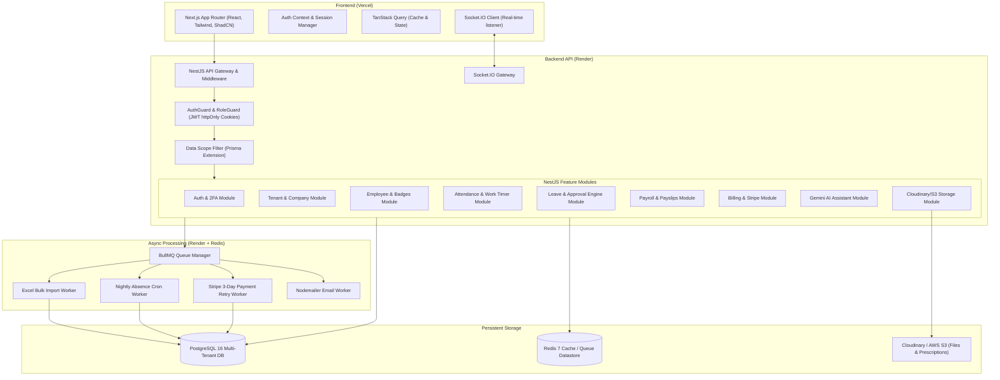

# Architecture Research

**Domain:** Multi-Tenant SaaS HRMS
**Researched:** 2026-10-26
**Confidence:** HIGH

## System Architecture

ZenHR is designed as a modular, decoupled full-stack architecture with strict separation of concerns between client UI, application API, background workers, and persistent data stores.

## Component Boundaries & Data Flow

1. **Authentication & Session Boundary**
   - Client sends credentials via HTTPS.
   - NestJS validates credentials, issues signed JWT access and refresh tokens stored in secure, `httpOnly`, `sameSite: lax` cookies.
   - Login metadata (IP address, user-agent, geolocation via IP lookup) is persisted to user profile.

2. **Multi-Tenancy & Data Scope Boundary**
   - Every request context carries `user.companyId`, `user.role`, and `user.dataScope`.
   - Tenant isolation interceptor automatically injects `where: { companyId }` into all Prisma client queries.
   - Data scope checks verify row ownership:
     - `PLATFORM`: Platform-level aggregate or support mode only.
     - `COMPANY`: `where: { companyId }`.
     - `DEPARTMENT`: `where: { companyId, departmentId }`.
     - `TEAM`: `where: { companyId, teamId }`.
     - `SELF`: `where: { companyId, employeeId: user.id }`.

3. **Real-Time Notification Pipeline**
   - Event occurs (e.g., employee pauses work timer for a break, or applies for leave).
   - Controller/Service emits internal event.
   - Socket.IO gateway broadcasts to connected user rooms (`user:{id}`, `role:{role}:{companyId}`).
   - Asynchronous BullMQ email job dispatches formatted email notification via Nodemailer.

4. **Background Job & Worker Pipeline**
   - Long-running jobs (Excel employee import, Nightly absence checks, Stripe 3-day retries) are dispatched to Redis queues via BullMQ.
   - Workers execute isolated jobs, update PostgreSQL records, generate PDF payslips, and dispatch notifications upon completion.

5. **Cloud Object Storage Pipeline**
   - File uploads (medical prescriptions, contracts, profile pictures) are handled via Multer and streamed directly to Cloudinary or AWS S3.
   - Only the resulting secure HTTPS URL is persisted in the PostgreSQL database.

## Build Order Dependencies

1. **Phase 1: Foundation & RBAC Infrastructure** (Monorepo setup, PostgreSQL schema, Prisma migrations, Multi-tenant middleware, JWT auth, 7 roles & 5 data scopes).
2. **Phase 2: Company Structure & Employee Management** (Departments, designations, employee directory, profile, status badges, Cloudinary/S3 file storage).
3. **Phase 3: Attendance, Work Timer & Real-Time Engine** (Onsite/Remote check-in, Socket.IO gateway, Work Timer with break notifications, overtime calculation, nightly absence BullMQ cron, IP tracking/whitelist).
4. **Phase 4: Configurable Approval Engine & Leave Management** (Shared approval routing engine, 3-month probation gating, Casual/Sick/Annual leave, HR leave modal with prescription download, Resource Requests).
5. **Phase 5: Payroll & Bulk Processing Pipeline** (Salary structures, monthly payroll runs, single/bulk PDF generation, Excel bulk employee import worker).
6. **Phase 6: Billing, Gemini AI & Security Hardening** (Two-tier Basic/Premium plan gating, Stripe checkout widget, 3-day retry cron, 2-month lockout, Gemini AI assistant, Super Admin support mode).
7. **Phase 7: Analytics, Dashboards & Production Deployment** (7 role-scoped dashboards, Recharts analytics, Vercel frontend & Render backend deployment configs, CI/CD).
